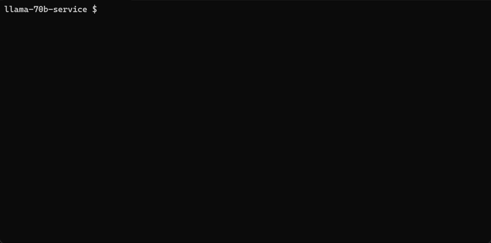
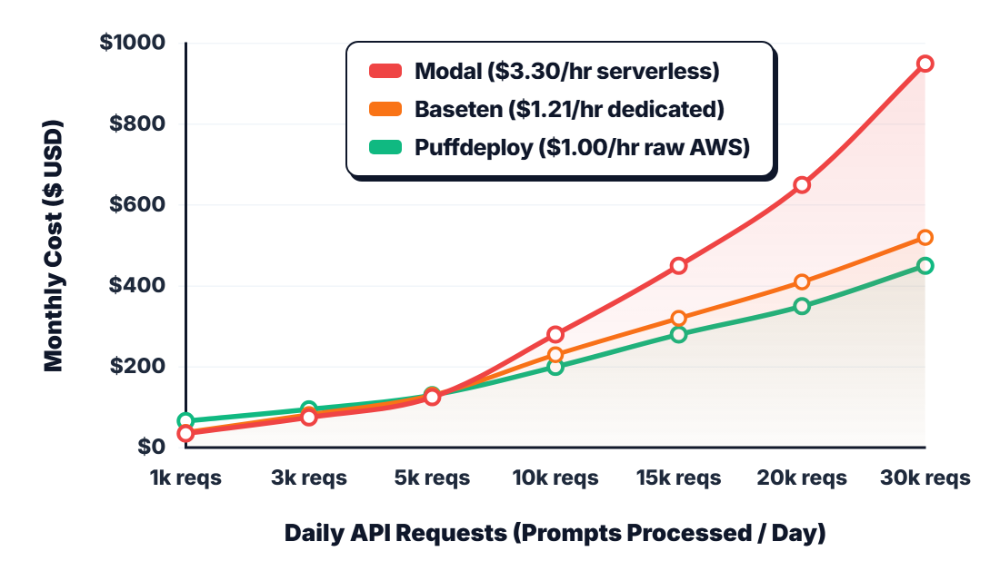

# Puffdeploy 🐡

Deploy open-source LLMs directly to your own AWS account with one command. Zero Docker, zero Kubernetes, scale-to-zero.

<p align="center">
  
</p>

**Contents**
- [Status](#status)
- [Introduction](#introduction)
    - [What is this?](#what-is-this)
    - [Cool, but why not just use Modal, RunPod, or Baseten?](#cool-but-why-not-just-use-modal-runpod-or-baseten)
    - [Cost comparison: Serverless markup vs. raw AWS](#cost-comparison-serverless-markup-vs-raw-aws)
    - [Can it actually run heavy frontier models (like Llama 3.1 70B)?](#can-it-actually-run-heavy-frontier-models-like-llama-31-70b)
    - [What are the benefits?](#what-are-the-benefits)
    - [What can I build with this?](#what-can-i-build-with-this)
- [Getting started](#getting-started)
- [Clean Up](#clean-up)
- [CLI Reference](#cli-reference)
- [Contributing](#contributing)
- [License](#license)
- [Credits](#credits)

## Status

- [x] Alpha: Under heavy development
- [ ] Beta: Ready for use. But go easy on us, there may be a few kinks.
- [ ] 1.0: Use in production!

This repo is still under heavy development and the documentation is evolving. You're welcome to try it, but expect some breaking changes. Watch "releases" of this repo to receive a notification when we are ready for Beta. And give us a star if you like it!

## Introduction

#### What is this?

This is a CLI and deployment engine that allows you to deploy open-source LLMs directly to your own cloud account (AWS) with a single command.

It works like this:

1. the CLI reads your model code (`app.py`) and hardware spec (`puff.yaml`)
2. it provisions an optimized Spot or On-Demand instance (via SkyPilot) directly inside your cloud account
3. it prepares the runtime, loads the weights, verifies the health probe, and prints a ready-to-test `curl` command.

#### Cool, but why not just use Modal, RunPod, or Baseten?

A few reasons:

1. **Your data, prompts, and weights never leave your own AWS account.** Zero third-party servers, and zero SOC2, HIPAA, or GDPR compliance headaches.
2. **Zero enterprise paywall for private VPCs.** You don't have to pay a $50k–$100k/year enterprise contract just to deploy inside your private VPC. Puffdeploy gives you that exact serverless developer experience natively inside your own account on day one.
3. **Zero framework lock-in.** No proprietary decorators (`@modal.function` or `@app.cls`). Write pure, standard FastAPI and Hugging Face / vLLM.
4. **100% Cloud Credit friendly.** Startups with AWS Activate ($10k–$100k+) burn free credits instead of corporate credit cards. Managed serverless GPU platforms force you to put your compute on a corporate credit card.

#### Cost comparison: Serverless markup vs. raw AWS

<p align="center">
  
</p>

At low hobby traffic (< 4k requests/day), serverless GPU platforms like Modal and Baseten win on idle cost. But once you serve paying users in production (> 5k requests/day), serverless GPU markups compound rapidly. At 30k requests/day, Modal burns **$950/mo** on credit cards, while Puffdeploy caps at **$450/mo** On-Demand (or **$0.00** cash via AWS Activate).

#### Can it actually run heavy frontier models (like Llama 3.1 70B)?

Yes. In fact, that's the primary reason we built this.

Managed serverless platforms make it easy to deploy small toy models, but running a 70B model on their hardware markup burns $10–$15+/hr on corporate credit cards. 

Puffdeploy was designed from day one for multi-GPU inference engines like **vLLM** with Tensor Parallelism. In the repository, you'll find a battle-tested blueprint ready to roll:

- **Model:** Meta Llama 3.1 70B Instruct (AWQ INT4)
- **Serving Engine:** vLLM with `tensor_parallel_size=4`
- **Infrastructure:** 4x NVIDIA L4 (`g6.12xlarge`) on AWS Spot
- **Cost:** **~$1.34/hr** (instead of $12+/hr on managed SaaS)

You can inspect the exact code in [`examples/llama-70b-service`](examples/llama-70b-service) and deploy it directly:
```bash
cd examples/llama-70b-service
puff deploy
```
*(Note: Multi-GPU clusters require 48 GPU vCPUs in AWS Service Quotas for the `g6.12xlarge` family. If your account is brand new with 0 GPU quota, start with the smoke test below).*


#### What are the benefits?

1. **Security perimeter:** The beauty of deploying directly to your own cloud account is that your proprietary data, customer queries, and model weights never leave your VPC. Zero third-party compliance reviews needed.
2. **Cost efficiency:** Puffdeploy defaults to Spot instances (`use_spot: true`), allowing you to serve models on AWS without burning $1,500+/mo on idle, unmanaged GPUs.
3. **Battle-tested compute engine:** Built on [SkyPilot](https://github.com/skypilot-org/skypilot), an extremely robust open-source cloud compute orchestrator developed at UC Berkeley.

#### What can I build with this?

1. Private LLM inference APIs (Qwen, Llama 3.1, Mistral, or your own custom LLMs)
2. Custom embedding & reranking microservices
3. Real-time reasoning and agent tool-calling backends
4. Domain-specific fine-tuned models hosted securely inside your VPC
5. High-throughput batch inference endpoints


## Getting started (90-Second Smoke Test)

New AWS accounts have 0 GPU quota by default. To verify your AWS credentials, permissions, and VPC networking in under 10 minutes without waiting days for AWS quota approval, deploy this lightweight smoke test first:

1. Install & Verify AWS Access
```bash
pip install puffdeploy
puff check
```

2. Initialize Service
```bash
mkdir llm-service
cd llm-service
```

3. Create `app.py`

Paste this into `app.py`:

```python
from fastapi import FastAPI
from transformers import pipeline

app = FastAPI()
pipe = pipeline("text-generation", model="Qwen/Qwen2.5-0.5B-Instruct")

@app.get("/health")
def health():
    return {"status": "ok"}

@app.post("/predict")
def predict(data: dict):
    result = pipe(data["prompt"], max_new_tokens=50)
    return {"response": result[0]["generated_text"]}
```

4. Create `puff.yaml`

Paste this into `puff.yaml`:

```yaml
name: llm-service
compute:
  cloud: aws
  region: us-east-1
  cpus: 4+
  memory: 8+
  use_spot: true
runtime:
  setup: pip install fastapi uvicorn "transformers<5.0.0" accelerate
```

5. Deploy to AWS
```bash
puff deploy
```

Puffdeploy provisions the AWS instance, installs dependencies, verifies the `/health` probe, and outputs your live replica URL.

6. Test Your Live Endpoint

Query your live inference API using `curl`:

```bash
curl -X POST http://<ENDPOINT_IP>:8000/predict \
  -H "Content-Type: application/json" \
  -d '{"prompt": "Explain LLM cold starts in 2 sentences."}'
```

7. Clean Up

When finished testing, terminate all cloud compute to avoid lingering charges:

```bash
puff down --all
```

---

## 🛠️ CLI Reference

| Command | Description |
| :--- | :--- |
| `puff check` | Verifies AWS credentials, permissions, and GPU quotas. |
| `puff init <name>` | Scaffolds a new model project with standard FastAPI and `puff.yaml`. |
| `puff deploy` | Provisions infrastructure and deploys the active model service. |
| `puff status` | Lists all active services, endpoints, replicas, and hourly spend. |
| `puff logs <name> --follow` | Streams live container and inference logs from AWS. |
| `puff down --name <name>` | Stops and terminates replicas for a specific service. |
| `puff down --all` | Destroys all clusters, workers, and controller nodes back to $0.00/hr. |

---

## Contributing

We welcome issues and pull requests. See [CONTRIBUTING.md](CONTRIBUTING.md) for local development setup.

## License

This repo is licensed under Apache 2.0.

## Credits

- [https://github.com/skypilot-org/skypilot](https://github.com/skypilot-org/skypilot) - A lot of this implementation leveraged the amazing work already done on SkyPilot.
- [https://github.com/basetenlabs/truss](https://github.com/basetenlabs/truss) - Model packaging and serving conventions are powered by the amazing Truss framework.
